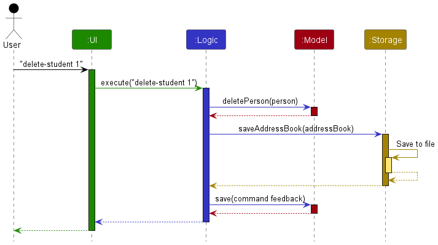
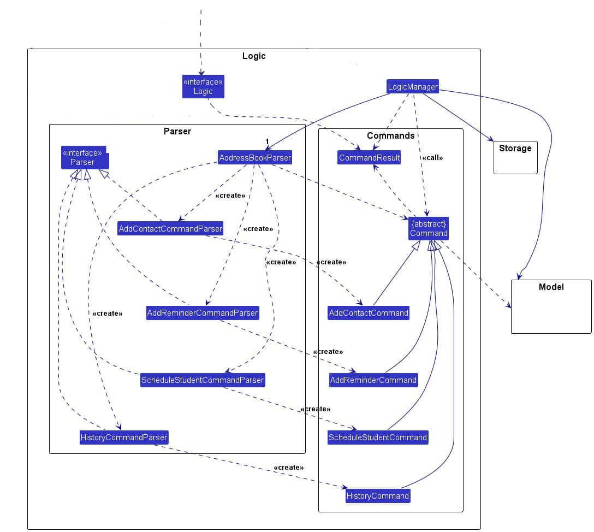
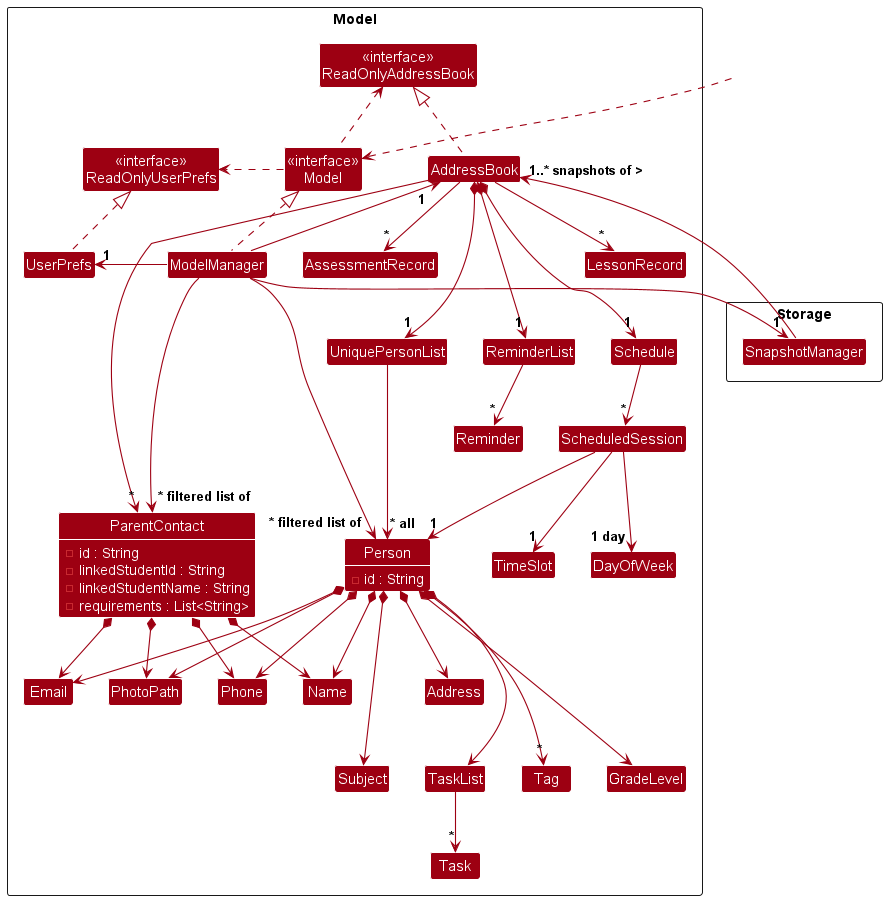
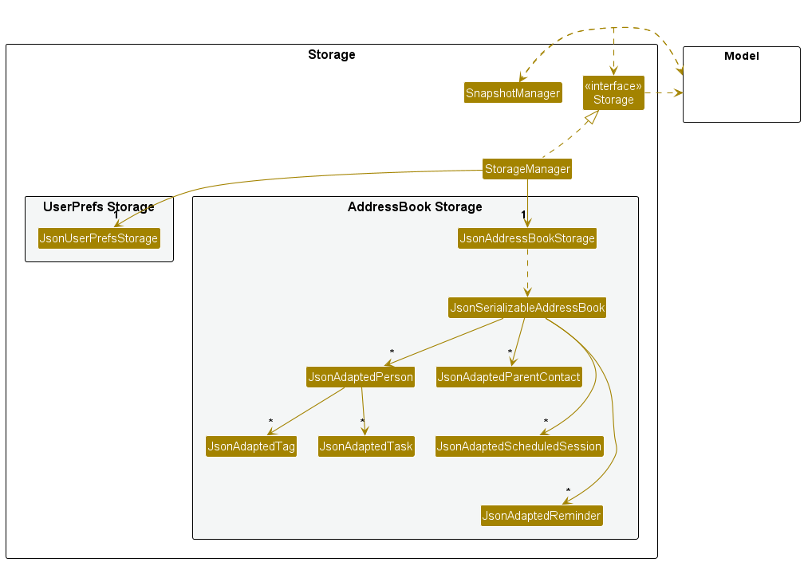
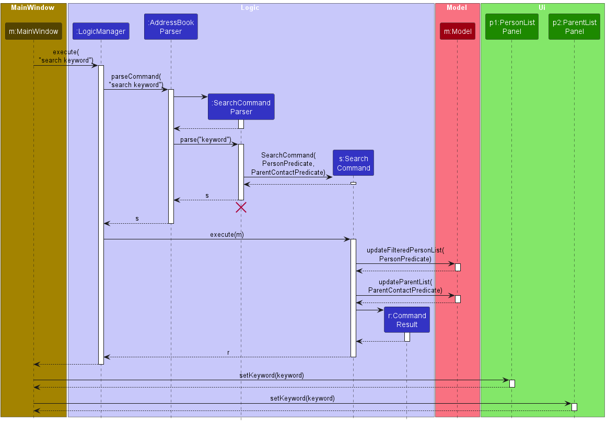

* Table of Contents
{:toc}

--------------------------------------------------------------------------------------------------------------------

## **Acknowledgements**

The team used AI tools, including [Claude](https://claude.ai/), [ChatGPT](https://chatgpt.com/), and
[GitHub Copilot](https://github.com/features/copilot), to help write most of Tutoria's code.

--------------------------------------------------------------------------------------------------------------------

## **Setting up, getting started**

Refer to the guide [_Setting up and getting started_](SettingUp.md).

--------------------------------------------------------------------------------------------------------------------

## **Design**

:bulb: **Tip:** The `.puml` files used to create diagrams are in `docs/diagrams`. Refer to the [_PlantUML Tutorial_ at se-edu/guides](https://se-education.org/guides/tutorials/plantUml.html) to learn how to create and edit diagrams.

### Architecture

The ***Architecture Diagram*** given above explains the high-level design of the App.
It omits some direct dependencies, including the model's use of snapshot management and logging; see the [Model component](#model-component) section.

The following provides a quick overview of the main components and their interactions.

**Main components of the architecture**

**`Main`** (consisting of classes [`Main`](https://github.com/AY2627S1-CS2103T-F09-4/tp/blob/master/src/main/java/seedu/address/Main.java) and [`MainApp`](https://github.com/AY2627S1-CS2103T-F09-4/tp/blob/master/src/main/java/seedu/address/MainApp.java)) is in charge of the app launch and shut down.
* At app launch, it initializes the other components in the correct sequence, and connects them up with each other.
* At shut down, it shuts down the other components and invokes cleanup methods where necessary.

The bulk of the app's work is done by the following four components:

* [**`UI`**](#ui-component): The UI of the App.
* [**`Logic`**](#logic-component): The command executor.
* [**`Model`**](#model-component): Holds the data of the App in memory.
* [**`Storage`**](#storage-component): Reads data from, and writes data to, the hard disk.

[**`Commons`**](#common-classes) represents a collection of classes used by multiple other components.

**How the architecture components interact with each other**

The *Sequence Diagram* below shows how the components interact with each other for the scenario where the user issues the command `delete-student 1`.

After saving the modified data, `Logic` asks `Model` to save a snapshot for undo and redo.

Each of the four main components (also shown in the diagram above),

* defines its *API* in an `interface` with the same name as the Component.
* provides its functionality through a concrete `{Component Name}Manager` class that implements the corresponding API interface.

For example, the `Logic` component defines its API in `Logic.java` and implements it in `LogicManager.java`. Other components interact with a component through its interface rather than its concrete class, preventing them from coupling to that component's implementation, as illustrated in the following partial class diagram.

The sections below give more details of each component.

### UI component

The **API** of this component is specified in [`Ui.java`](https://github.com/AY2627S1-CS2103T-F09-4/tp/blob/master/src/main/java/seedu/address/ui/Ui.java)

The UI consists of a `MainWindow` that is made up of parts such as `CommandBox`, `ResultDisplay`, `StatusBarFooter` and an optional `HelpWindow`. The main area of the window has four tabs, each shown by its own panel: `PersonListPanel` (Students), `ParentListPanel` (Parents), `SchedulePanel` (Schedule) and `CommandListPanel` (Commands). Each panel creates one card for every item it displays:

* `PersonListPanel` creates a `PersonCard` for each student.
* `ParentListPanel` creates a `ParentContactCard` for each parent contact.
* `SchedulePanel` uses a `ScheduleGrid` to arrange a `ScheduleSessionCard` for each scheduled session.
* `CommandListPanel` creates a `CommandCard` for each `CommandSummary` in `HelpCommand.COMMAND_SUMMARIES`.

`MainWindow` also owns a `ReminderAlertScheduler`, which regularly checks whether any reminder has become due, and may show a `ReminderDialog` listing the reminders. `MainWindow`, its parts, the panels, `PersonCard` and `ParentContactCard` inherit from the abstract `UiPart` class, which captures common behavior among classes that represent visible GUI parts. `ScheduleGrid`, `ScheduleSessionCard`, `ReminderDialog` and `ReminderAlertScheduler` do not extend `UiPart`.

The `UI` component uses the JavaFX UI framework. The layouts of the `UiPart`s are defined in matching `.fxml` files in `src/main/resources/view`. For example, [`MainWindow.fxml`](https://github.com/AY2627S1-CS2103T-F09-4/tp/blob/master/src/main/resources/view/MainWindow.fxml) specifies the layout of [`MainWindow`](https://github.com/AY2627S1-CS2103T-F09-4/tp/blob/master/src/main/java/seedu/address/ui/MainWindow.java), including its four tabs. The contents of the timetable in `SchedulePanel` are laid out in code by `ScheduleGrid`.

The `UI` component,

* executes user commands using the `Logic` component. `CommandBox` passes the text the user enters to `MainWindow`, which calls `Logic#execute(String)` and shows the feedback in `ResultDisplay`. `MainWindow` also switches to the Students tab after `list-students` commands and to the Parents tab after parent commands such as `add-parent`.
* listens for changes to `Model` data so that the UI can be updated with the modified data. The panels observe the lists exposed by `Logic` (the displayed students, the parent contacts and the scheduled sessions), so they redraw automatically when the data changes.
* keeps a reference to the `Logic` component, because the `UI` relies on the `Logic` to execute commands and to obtain the data it displays.
* depends on some classes in the `Model` component because it displays `Person`, `ParentContact`, `ScheduledSession` and `Reminder` objects from the model.

#### Schedule tab

`SchedulePanel` shows the scheduled sessions as a weekly timetable with a legend below it. It redraws whenever the scheduled sessions, the students or the displayed student list change.

* `ScheduleGrid` draws one row for each day of the week, with time running from left to right. Each session becomes a `ScheduleSessionCard` placed according to its day and time slot.
* Each card starts and ends at the session's exact times, so a 13:10 end and a 13:20 end are drawn at different places. The exception is a session shorter than 30 minutes: its card is drawn 30 minutes long (but never past midnight), because a narrower card is too small to show its details. The card still shows the session's real times. Each card is only as tall as its details need. A card that overlaps earlier cards on the same day is placed just below them, which can make that day's row taller.
* The timetable can be focused with Tab. Left and right arrows then scroll by one hour, up and down arrows by one row, Page Up and Page Down by one screen, and Home and End jump to the earliest and latest hours.
* Each student is given a colour based on their position in the student list, so all of a student's sessions share one colour. The legend lists the scheduled students and their colours.
* Each card shows the student's name, subject, grade level, address, time slot and session number. The title also includes the student's index in the displayed student list. If the student is not in the displayed list, for example after a `search` command, the title shows the name without an index; the other card details remain visible. A detail too long for one line wraps onto the next, and that day's row grows so the whole card shows.

#### Help tab

`CommandListPanel` lists every command in the app, so users can look up a command without leaving the main window.

* The list comes from `HelpCommand.COMMAND_SUMMARIES`. Each `CommandSummary` holds a command word, its parameter format and a short description. When adding a new command, add a `CommandSummary` for it there so that it shows up in the list.
* The list is read-only. `CommandListPanel` wraps it in an unmodifiable `ObservableList` so the `ListView` cannot change it.
* Executing `help` returns a `CommandResult` with `isShowHelp()` set, and `MainWindow` then switches to the Help tab instead of opening a separate window.
* The banner above the list points users to `F1` for the full user guide. `F1` is the accelerator of the **F1 User Guide** menu item, which opens `HelpWindow` with the user guide URL and a button to copy it. `HelpWindow` has its own scene, so the main window's `Esc` filter never sees its key presses; it adds its own filter that hides the window on `Esc`. The panel does not open a browser itself, so it does not depend on `java.awt.Desktop` or the system clipboard.

### Logic component

**API** : [`Logic.java`](https://github.com/AY2627S1-CS2103T-F09-4/tp/blob/master/src/main/java/seedu/address/logic/Logic.java)

Here's a (partial) class diagram of the `Logic` component:

The sequence diagram below illustrates the interactions within the `Logic` component, taking the `execute("delete-student 1")` API call as an example.

:information_source: **Note:** The lifeline for `DeleteCommandParser` should end at the destroy marker (X), but due to a limitation of PlantUML, it continues to the end of the diagram.

How the `Logic` component works:

1. When `Logic` is called upon to execute a command, the command is passed to an `AddressBookParser` object. Depending on the command word, it either uses a command-specific parser (e.g., `DeleteCommandParser`) or creates the command directly (e.g., `HelpCommand`).
2. This results in a `Command` object (more precisely, an object of one of its subclasses e.g., `DeleteCommand`) which is executed by the `LogicManager`. 
3. The command can communicate with the `Model` when it is executed. In the example, `DeleteCommand` obtains the filtered student list, resolves the index and deletes the selected student.
4. The result of the command execution is encapsulated as a `CommandResult` object which is returned from `Logic`.

Here are the other classes in `Logic` (omitted from the class diagram above) that are used for parsing a user command:

How the parsing works:
* For a command that needs a command-specific parser, `AddressBookParser` creates an `XYZCommandParser` (`XYZ` is a placeholder for the specific command name, e.g., `AddCommandParser`). The parser uses the other classes shown above to parse the arguments and create an `XYZCommand` object (e.g., `AddCommand`). The `AddressBookParser` returns that object as a `Command` object.
* All `XYZCommandParser` classes, such as `AddCommandParser` and `DeleteCommandParser`, implement the `Parser` interface so they can be treated similarly where appropriate, for example during testing.

### Model component

**API** : [`Model.java`](https://github.com/AY2627S1-CS2103T-F09-4/tp/blob/master/src/main/java/seedu/address/model/Model.java)

The `id` field shown for `Person` represents its `studentId` field in the current code.

The `Model` component,

* stores the address book data i.e., all `Person` objects (which are contained in a `UniquePersonList` object) and `ParentContact` objects (which are contained in an `ObservableList` object).
* stores the `Person` objects selected by the current filter, such as search results, in a separate _filtered_ list. It exposes this list as an unmodifiable `ObservableList<Person>` that the UI can observe and bind to, so the UI updates when the list changes.
* stores the `ParentContact` objects in a similar way.
* stores `Reminder` objects in a `ReminderList`, which exposes them as an unmodifiable `List<Reminder>`.
* stores `ScheduledSession` objects in a `Schedule`, which exposes them as an unmodifiable `ObservableList<ScheduledSession>`.
* stores a `UserPrefs` object that represents the user’s preferences (currently, just the GUI settings). This is exposed to the outside as a `ReadOnlyUserPrefs` object.
* stores `AssessmentRecord` and `LessonRecord` objects in lists in the `AddressBook` object.
* uses `SnapshotManager` from the `storage` package to retain `AddressBook` snapshots for undo and redo. The search predicates in the model also reference `LogicManager` as a logging category. These are direct dependencies on other components.
* uses other model classes, such as `PersonContainsKeywordsPredicate`, to filter data for commands; these are omitted from the class diagram.

### Storage component

**API** : [`Storage.java`](https://github.com/AY2627S1-CS2103T-F09-4/tp/blob/master/src/main/java/seedu/address/storage/Storage.java)

The `Storage` component,
* can save both address book data and user preference data in JSON format, and read them back into corresponding objects.
* is implemented by `StorageManager`, which delegates the actual JSON file access to `JsonAddressBookStorage` and `JsonUserPrefsStorage` (one class per data file).
* depends on some classes in the `Model` component (because the `Storage` component's job is to save/retrieve objects that belong to the `Model`)

### Common classes

Classes used by multiple components are in the `seedu.address.commons` package.

--------------------------------------------------------------------------------------------------------------------

## **Implementation**

This section describes some noteworthy details on how certain features are implemented.

### Parent contact editing
Edits an existing ParentContact in the address book. Users can update the parent's name, phone number, email, 
linked student, and requirements. Unspecified fields retain their existing values.

1. `EditParentCommandParser` parses the user's input in the format `edit-parent INDEX [n/NAME] [p/PHONE] [e/EMAIL] [link/STUDENT_INDEX] [r/REQUIREMENT]....`
   * Unsupported prefixes, duplicate single-valued prefixes, and invalid field values are rejected with a specific error reason followed by `EditParentCommand.MESSAGE_USAGE`, using the shared withUsage helper.
   * Invalid parent and student indices produce error messages identifying which index is invalid.

2. `EditParentCommandParser` distinguishes between fields that are omitted and fields that are explicitly cleared.
   * Omitted name, phone, and email fields retain their existing values. Supplied values are validated using the existing field validators.
   * If `link/` is omitted, the existing student link is retained. If a student `index` is supplied, the parent is linked to that student. An empty `link/` clears both the `linked` student `ID` and `name`.
   * If `r/` is omitted, the existing requirements are retained. One or more supplied requirements replace the existing list in their input order. A single empty `r/` clears all requirements. Empty requirement entries cannot be mixed with other requirements.

3. `EditParentCommand` retrieves the parent to edit using its `index` in `Model.getParentContactList()` and resolves the `linked` student using its index in `Model.getFilteredPersonList()`.
   * The student `link` stores both the student's persistent `ID` and `name`.
   * `Link` conflicts and duplicate parent identities are checked against the full address book rather than filtered lists, preventing filtering from hiding existing conflicts.
   * The edited parent is excluded from duplicate identity checks using its ID, allowing the parent to be linked to their current student again.
   * All validation is completed before `setParentContact` is called, ensuring that validation failures do not partially modify the parent. Execution validation failures also include the reason and usage instructions.

4. The updated `ParentContact` preserves the original parent's `ID` and `photo`, along with all fields that were not explicitly edited. The replacement also supports parents without an `email`, as `ParentContact.copy()` preserves optional null email values.

5. The changes are compatible with the existing storage format and do not require a storage migration.
   * `Requirements` remain stored as a `List<String>` in `ParentContact` and as a `JSON` array in `JsonAdaptedParentContact`.

6. The following tests verify the command's behaviour:
   * `EditParentCommandParserTest` covers invalid command syntax and error feedback.
   * `EditParentCommandTest` covers field edits, `student` linking and clearing, filtered `student` indices, hidden `link` conflicts, `requirement` replacement and clearing, validation without mutation, `photo` preservation, `JSON` save/reload, and `undo`/`redo`.

### Search

Searches all _user-visible_ attributes of `Person` and `ParentContact` objects in the `AddressBook` for the user's keyword and highlights them for the user. This means that search will exclude words that users are not meant to see, such as `studentId`.

How `Search` works:
1. `SearchCommandParser` parses the user's input and creates the predicates required to match the `keyword`. These predicates are used to construct a `SearchCommand`.
2. `SearchCommand` uses the model interface to filter the displayed `Person` and `ParentContact` lists through `ModelManager`, retaining entries that match the keyword.
3. The command returns a `CommandResult` containing the `keyword` needed for highlighting. This result is passed to the `UI`.
4. The relevant `UI` controllers use the `keyword` to highlight matching occurrences in the displayed attributes of the filtered `Person` and `ParentContact` objects.
5. To prevent search filtering from affecting subsequent commands, `MainWindow` resets the filtered lists to reflect the address book's entries after commands other than `SearchCommand`.

This is illustrated in the following diagram:

### Undo and Redo

`Undo` reverses changes to the `AddressBook` and `Redo` reverses the changes made by `Undo`. 

Take note:
* If a command doesn't change the `AddressBook` (For example `help`), `Undo` will ignore it. This also applies to `Redo`.
* If some changes were undone and new changes are introduced, the changes that could have been redone will be lost.

How `Undo`/`Redo` works:
1. Whenever a command is executed, `SnapshotManager` saves a snapshot of the current `AddressBook` and the relevant command text in separate `List` objects. `currentIndex` tracks the current position in the snapshot history.
2. `SnapshotManager` is managed by `ModelManager`, which provides access to the snapshot history for `undo` and `redo` operations.
3. When `UndoCommand` is executed, it uses `ModelManager` to move `currentIndex` back by one position and retrieve a copy of the corresponding `AddressBook` snapshot. The relevant command text is then included in the resulting `CommandResult`.
4. If a new command is executed after some changes have been undone, `currentIndex` is no longer at the end of the snapshot history. In this case, the snapshots beyond `currentIndex` are removed, discarding changes that could previously have been redone.
5. When `RedoCommand` is executed, it uses `ModelManager` to move `currentIndex` forward by one position and retrieve a copy of the corresponding `AddressBook` snapshot, restoring a previously undone change. The relevant command text is then included in the resulting `CommandResult`.

This is illustrated in the following diagrams:

When the program begins:

After a command:

After another command:

After `undo`:

After `redo`:

If from `undo`, a command that changes the AddressBook is executed:

Notice how the `Current Snapshot` is `ab3` rather than `ab2`.

If from `undo`, a command that doesn't change the AddressBook is executed:

### Recording student history and statistics

Lessons and assessments are stored as historical records in `AddressBook`, separate from the recurring weekly schedule.
Each record retains the student's ID and name from when it was recorded. Deleting a student removes their recurring
sessions but keeps their history; a newly created student has a different identity. `clear` removes both current data
and history.

How historical records and statistics work:
1. `AddressBookParser` routes history commands through `HistoryCommandParser` to `HistoryCommand`. The list commands
   display stored records; record, edit and delete operations update the history through `Model.setHistory`.
2. `record-assessment` resolves the student against the displayed student list and stores their ID and name with the
   assessment. Editing an assessment preserves its record ID and student ID.
3. `StatsCommandParser` parses `stats` and `stats-student` into `StatsCommand`. It requires both date boundaries or
   neither; when omitted, the range is January 1 through today according to the model clock. A student report resolves
   its index against the displayed student list.
4. `StatsCommand` passes the address book, student (if selected) and inclusive date range to `StatisticsReport`. The
   business report summarizes completed-lesson counts, teaching hours, distinct students and monthly workload; it
   reports workload, not profitability. The student report shows lesson counts by outcome and assessment percentages.
   Its attendance rate is completed / (completed + absent), excluding cancelled and unrecorded lessons, and its
   assessment change compares the first and last percentages by subject and category. The formatted report is
   returned in a `CommandResult`. Reports and history-list commands are read-only; a missing attendance denominator
   or fewer than two comparable marks produces N/A.

### Marking attendance

Each dated attendance outcome is stored as a `LessonRecord` linked to a recurring `ScheduledSession`.

How attendance is recorded:
1. `AddressBookParser` routes `mark-attendance` through `MarkAttendanceCommandParser` to `MarkAttendanceCommand`.
   `list-schedule` sorts sessions for display but labels each with its position in the stored schedule; the command
   resolves `Session #N` against that complete schedule. The date must match the session's weekday and be no later
   than today, and the outcome must be completed, absent, cancelled or unrecorded.
2. The first mark creates a lesson linked by the session ID and captures the student's ID and name, subject, date and
   session times. A later mark for the same session and date updates only the outcome. A new mark is rejected if the
   student already has a lesson on that date with the same start and end times. The command stores the result through
   `Model.setHistory` and returns a `CommandResult`.
3. `list-lessons` sorts records by date and start time while showing each record's stored `Lesson #N`. `delete-lesson`
   uses that number to remove a history record, not a recurring session. Removing a session or deleting its student
   does not remove dated history, and an unmarked session creates no lesson or implied absence.

--------------------------------------------------------------------------------------------------------------------

## **Documentation, logging, testing, dev-ops**

* [Documentation guide](Documentation.md)
* [Testing guide](Testing.md)
* [Logging guide](Logging.md)
* [DevOps guide](DevOps.md)

--------------------------------------------------------------------------------------------------------------------

## **Appendix: Requirements**

### Product scope

**Target user profile**:

* needs to manage large numbers of contacts
* needs to manage different kinds of contacts (students, parents, coworkers)
* needs to manage information within contacts
* prefers desktop apps over other types of applications
* can type fast
* prefers typing to mouse interactions
* is reasonably comfortable using CLI apps

**Value proposition**: Tutoria keeps student and parent information, schedules, student statistics, and reminders so that tutors can manage their work and review student progress.

### User stories

Priorities: High (must have) - `* * *`, Medium (nice to have) - `* *`, Low (unlikely to have) - `*`.

| Priority | As a… | I want to… | So that I can… |
|----------|-------|------------|----------------|
| `* * *` | tutor | create, view and delete student profiles and their information | manage my students' details |
| `* * *` | tutor | edit a student's existing information | keep the profile current when details change |
| `* * *` | tutor | add tasks to students | know what work each student needs to do |
| `* * *` | tutor | add parent profiles and link them to students | keep parent contacts and requirements together |
| `* * *` | tutor | add photos to student and parent profiles | tell contacts apart |
| `* * *` | tutor | search student and parent details | find client information quickly |
| `* * *` | tutor | record assessments and view student progress statistics | evaluate attendance and assessment results |
| `* * *` | tutor | mark attendance for scheduled sessions | keep an accurate record of lesson outcomes |
| `* * *` | tutor | keep my records between launches | continue managing information after restarting Tutoria |
| `* *` | first-time user | have sample data | explore the features |
| `* *` | first-time user | have a user guide or help sheet | learn what features are available |
| `* *` | tutor | choose dates using a calendar pop-up | enter dates more easily |
| `* *` | tutor | search for information using keywords | find relevant records without scanning the full list |
| `* *` | returning user | see suggested questions about topics such as payment, food, address or phone number | remember what information to collect |
| `* *` | tutor | create, view and delete reminders, with due reminders shown in a pop-up | remember follow-up items |
| `* *` | tutor | receive notifications about tasks that need attention | avoid overlooking student work |
| `* *` | tutor | organise tasks in an Eisenhower matrix | know which tasks to prioritise |
| `* *` | tutor | filter and sort students by subject, grade level or other details | manage a selected group more efficiently |
| `* *` | power user | use keyboard shortcuts for common actions | navigate more quickly without relying on the mouse |
| `* *` | tutor | submit suggestions and feedback | request improvements to the app |
| `* *` | tutor | view the schedule for a selected day | see that day's activities across students |
| `* *` | tutor | undo and redo changes | recover from recent edits |
| `*` | tutor | change the path of the app's data file | organize app data on my computer |
| `*` | user who prefers a darker display | use a dark-mode interface | view the app more comfortably |

### Use cases

(For all use cases below, the **System** is Tutoria and the **Actor** is the tutor.)

**Use case: UC01 - Add a student**

**MSS**

1. The tutor enters `add-student` with the student's details.
2. Tutoria validates the details and adds the student.
3. Tutoria indicates success and displays the updated student list.

Use case ends.

**Extensions**

* 1a. Required details are missing or invalid.
    * 1a1. Tutoria displays an error and does not add the student.

    Use case resumes at step 1.

**Use case: UC02 - Manage a parent contact**

**MSS**

1. The tutor enters `add-parent` with the parent's details and, optionally, a student link and requirements.
2. Tutoria validates the details and creates the parent contact.
3. Tutoria indicates success and displays the parent list.

Use case ends.

**Extensions**

* 1a. The details are invalid or the selected student does not exist.
    * 1a1. Tutoria displays an error and does not create the parent contact.

    Use case resumes at step 1.

**Use case: UC03 - Manage a student's task**

**MSS**

1. The tutor selects a student and enters `add-task` with a task description.
2. Tutoria adds the task and displays the updated student details.
3. The tutor may mark the task done or delete it using its task ID.

Use case ends.

**Extensions**

* 1a. The student index or task description is invalid.
    * 1a1. Tutoria displays an error and leaves the task list unchanged.

    Use case resumes at step 1.

**Use case: UC04 - Schedule a weekly session**

**MSS**

1. The tutor selects a student and enters `schedule-student` with a weekday and start and end times.
2. Tutoria validates the student and time range, then adds the weekly session.
3. The tutor enters `list-schedule` to view the sessions and their `Session #N` labels.

Use case ends.

**Extensions**

* 1a. The student index or session details are invalid.
    * 1a1. Tutoria displays an error and does not add the session.

    Use case resumes at step 1.

**Use case: UC05 - Record attendance**

**MSS**

1. The tutor enters `list-schedule` and chooses a `Session #N`.
2. The tutor enters `mark-attendance` with that session number, a date and an outcome.
3. Tutoria validates the date and session, records the outcome and confirms the lesson record.

Use case ends.

**Extensions**

* 2a. The date is in the future or does not match the session's weekday.
    * 2a1. Tutoria displays an error and does not change the history.

    Use case resumes at step 1.

* 2b. A lesson for the same student, date and exact time already exists for a different session or has no session link.
    * 2b1. Tutoria identifies the existing lesson and does not create a duplicate.

    Use case ends.

**Use case: UC06 - Record an assessment and view student progress**

**MSS**

1. The tutor enters `record-assessment` with a student index, date, subject, category, title and mark.
2. Tutoria validates the details and records the assessment.
3. The tutor enters `stats-student` with the student's index and, optionally, a date range.
4. Tutoria displays the student's attendance and assessment report for that range.

Use case ends.

**Extensions**

* 1a. The assessment date or mark is invalid.
    * 1a1. Tutoria displays an error and does not record the assessment.

    Use case resumes at step 1.

* 3a. The date range is invalid.
    * 3a1. Tutoria displays an error and does not generate the report.

    Use case resumes at step 3.

**Use case: UC07 - Manage a reminder**

**MSS**

1. The tutor enters `add-reminder` with reminder text and, optionally, a date and time.
2. Tutoria stores the reminder and confirms the operation.
3. The tutor can use `list-reminders` to view reminders or `delete-reminder` to remove one by ID.

Use case ends.

**Use case: UC08 - Search for a contact**

**MSS**

1. The tutor enters `search` with a keyword.
2. Tutoria filters the displayed student and parent lists to matching contacts and highlights matching text.

Use case ends.

**Use case: UC09 - Delete a student**

**MSS**

1. The tutor enters `list-students` and selects a student index.
2. The tutor enters `delete-student` with that index.
3. Tutoria deletes the student and their recurring sessions, while retaining dated lesson and assessment history.
4. Tutoria confirms the deletion.

Use case ends.

**Extensions**

* 2a. The student index is invalid.
    * 2a1. Tutoria displays an error and does not delete a student.

    Use case resumes at step 1.

### Non-Functional Requirements

1. Tutoria is built for Java `25`; running it requires Java `25` or later.
2. Core workflows, including managing records and viewing schedules, can be performed through the command input without using a mouse.

### Glossary

* **Assessment record**: A dated assessment result associated with a student's persistent identity.
* **Lesson record**: A dated lesson outcome, optionally linked to the recurring session from which it was recorded.
* **Parent contact**: A contact profile that can store requirements and link to a student.
* **Scheduled session**: A recurring weekly time slot associated with a student.
* **Session #N**: The stored schedule position used by `mark-attendance`; it is not necessarily the displayed row number.
* **Student index**: The position of a student in the currently displayed student list.
* **Tutor**: The user who manages student and parent information in Tutoria.

--------------------------------------------------------------------------------------------------------------------

## **Appendix: Instructions for manual testing**

Use a test home folder for these procedures. Tutoria stores `preferences.json` and `data/addressbook.json` relative to
the folder from which it is launched. Do not use a folder containing data you want to keep. Replace placeholders such
as `<STUDENT_INDEX>` with values from the current list; do not type the angle brackets. Java `25` or later and the
release JAR are required.

### Launch and shutdown

1. Copy `tutoria.jar` into a new, empty test home folder. Open a terminal in that folder and run
   `java -jar tutoria.jar`.
   Expected: The GUI opens with sample contacts. Preferences are stored in `preferences.json` and address-book data is
   stored in `data/addressbook.json`, both relative to the test home folder.
2. Resize and move the window, then close Tutoria. Run `java -jar tutoria.jar` again from the same folder.
   Expected: The most recent window size and position are restored.
3. Enter `exit`.
   Expected: Tutoria closes.

### Managing students and parents

1. Add a student with `add-student n/Manual Test p/91234560 e/manual@example.com a/1 Test St s/Mathematics`.
   Expected: Tutoria adds the student and displays the updated student list.
2. Run `list-students`, then edit the new student's subject with `edit-student <STUDENT_INDEX> s/Science`, using the
   index shown in the list.
   Expected: The subject changes and the other student details remain unchanged.
3. Add a parent linked to that student with
   `add-parent n/Manual Parent p/91234561 link/<STUDENT_INDEX> r/Call before lessons`.
   Expected: The parent appears in `list-parents` with the requirement and student link. `view-child <PARENT_INDEX>`
   selects the linked student.

### Tasks and reminders

1. Use a student index from `list-students`. Run `add-task <STUDENT_INDEX> task/Prepare revision`, then use the task ID
   shown in the student details with `mark-task <STUDENT_INDEX> tid/<TASK_ID> status/done`.
   Expected: The task is shown as done. Run `delete-task <STUDENT_INDEX> tid/<TASK_ID>` and verify it is removed.
2. Run `add-reminder r/Manual test reminder`, then `list-reminders`.
   Expected: The reminder appears in the list and in the reminder pop-up the next time Tutoria starts. Close the
   pop-up; verify the reminder remains until removed with `delete-reminder <ID>`.

### Scheduling and attendance

1. For a student without that weekly time slot, run `schedule-student <STUDENT_INDEX> day/Monday from/16-00 to/17-00`,
   then `list-schedule`.
   Expected: The weekly session appears. Use its `Session #N` label, not its row number.
2. Replace `<DATE>` with a date on or before today that falls on the session's weekday. Run
   `mark-attendance <SESSION_NUMBER> date/<DATE> status/completed`.
   Expected: Tutoria records a lesson for that dated session. `list-lessons` shows the lesson.
3. Run `mark-attendance` again with the same session and date but `status/absent`.
   Expected: The existing lesson's outcome changes to absent; no second lesson is added.
4. Try a future date or a date that falls on a different weekday.
   Expected: Tutoria reports an error and leaves the lesson unchanged.

### Assessments and statistics

1. Record an assessment for a student, replacing `<DATE>` with a date that is not in the future:
   `record-assessment <STUDENT_INDEX> date/<DATE> subject/Mathematics category/Test title/Manual score/80 max/100`.
   Expected: The assessment appears in `list-assessments`.
2. Run `stats from/<DATE> to/<DATE>` and `stats-student <STUDENT_INDEX> from/<DATE> to/<DATE>`.
   Expected: The reports include the selected date range and the student's assessment for that date.
3. Update the record with
   `edit-assessment <RECORD_NUMBER> date/<DATE> subject/Mathematics category/Test title/Manual score/90 max/100`,
   then run `list-assessments` again.
   Expected: The selected assessment is updated. `delete-assessment <RECORD_NUMBER>` removes it.

### Deleting a student

1. Using the test student from the earlier steps, run `list-students` and note their displayed index.
2. Run `delete-student <STUDENT_INDEX>`.
   Expected: The student and recurring session disappear. Their lesson and assessment history remains in
   `list-lessons` and `list-assessments`, labelled with the deleted student's name.
3. Try `delete-student 0`, `delete-student x`, and an index larger than the displayed list.
   Expected: Each command reports an error and deletes no student.

### Search, undo and redo

1. Run `search <NAME_OR_KEYWORD>` for a student or parent that exists in the list.
   Expected: Matching student or parent details are displayed and matching text is highlighted. Run `list-students` or
   `list-parents` to show the full corresponding list again.
2. Add a uniquely named test student, then run `undo` followed by `list-students`.
   Expected: The newly added student is absent. Run `redo` and `list-students`.
   Expected: The student is restored.

### Student and parent walkthrough

This walkthrough uses fixed indices, so it starts from an empty Tutoria. Run `clear` first.

1. Students
   1. Run `add-student n/John Tan p/91234567 e/johntan@example.com a/Blk 22 Ang Mo Kio Ave 3 s/Mathematics g/Sec 2`.
      Expected: The student `John Tan` is created and appears in the `Students` tab.
   2. Run `edit-student 1 p/12345678 g/`.
      Expected: `John Tan`'s phone number changes from `91234567` to `12345678` and his grade level is removed.
   3. Run `add-task 1 task/do homework`.
      Expected: The task `do homework` appears in red on the right of `John Tan`'s card.
   4. Run `mark-task 1 tid/1 status/done`.
      Expected: `do homework` turns green.
   5. Run `mark-task 1 tid/1 status/not done`.
      Expected: `do homework` turns red again.
   6. Run `delete-task 1 tid/1`.
      Expected: `do homework` is removed from `John Tan`'s card.
   7. Run `add-student n/Jane Tan p/91234567 e/janetan@example.com a/Blk 22 Ang Mo Kio Ave 3 s/Mathematics`.
      Expected: `Jane Tan` is added at index 2.
   8. Run `search Jane`.
      Expected: `John Tan` disappears and only `Jane Tan` is left in the `Students` tab.
   9. Run `list-students`.
      Expected: The `Students` tab shows the same list as after step 7.
   10. Run `delete-student 2`.
       Expected: `Jane Tan` is removed from Tutoria.
   11. Run `clear`. Note that this clears _all_ data from Tutoria. You can undo this with `undo`.
       Expected: `John Tan` is removed from Tutoria.

2. Parents
   1. Run `add-parent n/Mrs Tan p/98765432`.
      Expected: The parent `Mrs Tan` is created and appears in the `Parents` tab.
   2. Run `add-student n/John Tan p/91234567 e/johntan@example.com a/Blk 22 Ang Mo Kio Ave 3 s/Mathematics g/Sec 2`.
   3. Run `edit-parent 1 p/12345678 link/1`.
      Expected: `Mrs Tan`'s phone number changes from `98765432` to `12345678`, and she is linked to `John Tan`.
   4. Run `view-child 1`.
      Expected: Tutoria switches to the `Students` tab and selects `Mrs Tan`'s linked student, `John Tan`.
   5. Run `add-parent n/Mr Tan p/98765432 link/1`.
      Expected: `Mr Tan` is added and linked to `John Tan`.
   6. Run `add-parent n/Mrs Lim p/98765432 link/1`.
      Expected: Tutoria rejects the command because `John Tan` already has two parents, `Mrs Tan` and `Mr Tan`.
   7. Run `search Mrs Tan`.
      Expected: Only `Mrs Tan` is shown in the `Parents` tab, because `search` matches the whole phrase `Mrs Tan`.
   8. Run `delete-parent 1`.
      Expected: `Mrs Tan` is removed.
   9. Run `list-parents`.
      Expected: Only `Mr Tan` is shown in the `Parents` tab.
   10. Run `clear`. Note that this clears _all_ data from Tutoria. You can undo this with `undo`.
       Expected: `Mr Tan` and `John Tan` are removed from Tutoria.

### Commands after searching

This shows how index-based commands behave after the displayed list is filtered. `delete-student` is used as an example,
but any command that takes an `INDEX` behaves the same way, including the parent commands.

1. Run `clear` to start from an empty Tutoria.
2. Run `add-student n/John p/91234567 e/john@example.com a/Blk 22 Ang Mo Kio Ave 3 s/Math`.
3. Run `add-student n/Jane p/91234567 e/jane@example.com a/Blk 22 Ang Mo Kio Ave 3 s/Math`.
   Expected: The list contains `John` at index 1 and `Jane` at index 2.
4. Run `search Jane`.
   Expected: The list contains only `Jane`, at index 1.
5. Run `delete-student 1`.
   Expected: `Jane` is deleted and the list shows `John` at index 1. `INDEX` refers to the filtered list shown after
   `search`, which contained only `Jane`, not the full list in which `Jane` was at index 2.

### Undo and redo walkthrough

1. Undoing and redoing a command
   1. Run `add-student n/John Tan p/91234567 e/johntan@example.com a/Blk 22 Ang Mo Kio Ave 3 s/Math`.
   2. Run `undo`.
      Expected: Tutoria returns to its previous set of students and parents, undoing the `add-student` command.
   3. Run `redo`.
      Expected: Tutoria restores the set of students and parents after the `add-student` command.
   4. Run `list-students`.
   5. Run `undo`.
      Expected: Tutoria undoes the `add-student` command. `list-students` did not change any students or parents, so
      `undo` skips it and acts on the last command that did. `redo` behaves the same way.
2. Redoing after undoing and running another command
   1. Run `add-student n/John Tan p/91234567 e/johntan@example.com a/Blk 22 Ang Mo Kio Ave 3 s/Math`.
   2. Run `undo`.
   3. Run `add-student n/Jane Tan p/91234567 e/janetan@example.com a/Blk 22 Ang Mo Kio Ave 3 s/Math`.
   4. Run `redo`.
      Expected: Tutoria reports `Nothing to redo!`, because the new `add-student` for `Jane Tan` replaces the undone
      `add-student` for `John Tan`.

### Saving data

1. In the test home folder, add a uniquely named student and then close Tutoria. Relaunch it from the same folder and run
   `list-students`.
   Expected: The student is still present, confirming that data-changing commands are saved automatically.
2. To test a missing data file, launch Tutoria from a separate empty test home folder with no `data/addressbook.json`.
   Expected: Tutoria starts with sample contacts.
3. To test a corrupted data file, first create a valid test dataset in a disposable test home folder and close Tutoria.
   Back up that folder's `data/addressbook.json` outside the test home, then replace the test copy's contents with
   invalid JSON and relaunch Tutoria from that folder.
   Expected: Tutoria logs a loading warning and starts with an empty address book. Do not enter any commands: commands
   that are not read-only, including commands that only display a list, save the in-memory address book and could
   overwrite the invalid file. Close the window and restore the backup before continuing.
