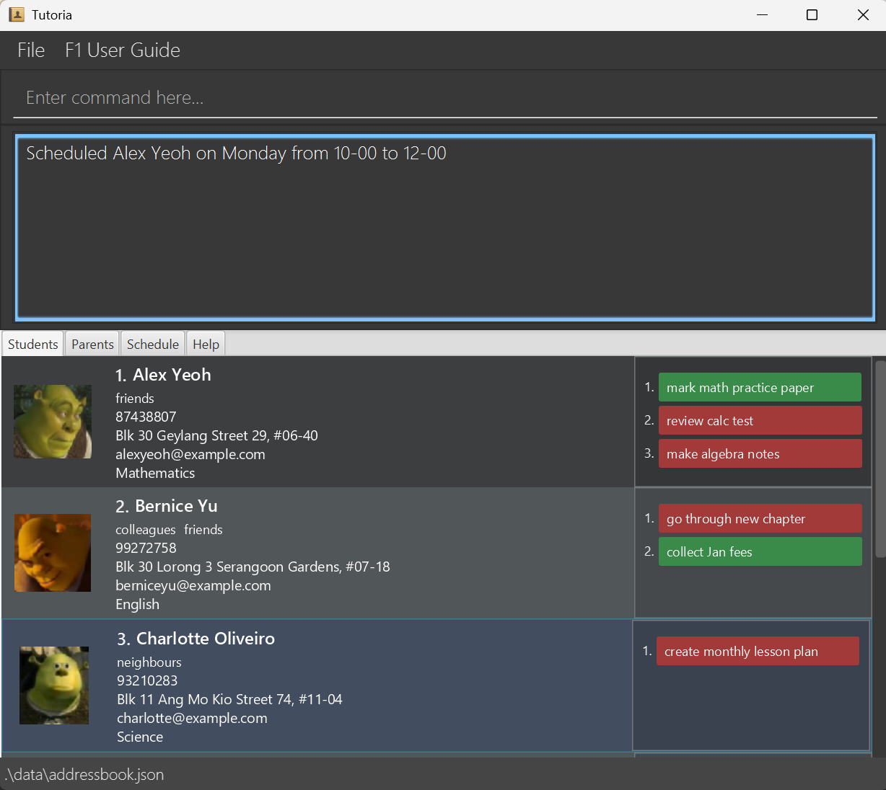

Tutoria is a **desktop application designed to help tutors manage students, parents, lessons, and teaching-related activities**. It is optimized for use through a Command Line Interface (CLI), while retaining the convenience of a Graphical User Interface (GUI).

Tutoria helps tutors maintain student and parent records, manage tasks and reminders, schedule lessons, record attendance and assessments, and view statistics on student progress and teaching workload.

* [Quick start](#quick-start)
* [Features](#features)
  * [General commands](#general-commands)
  * [Student management](#student-management)
  * [Parent management](#parent-management)
  * [Photos](#photos)
  * [Tasks](#tasks)
  * [Reminders](#reminders)
  * [Scheduling and attendance](#scheduling-and-attendance)
  * [Assessments and statistics](#assessments-and-statistics)
  * [Data management](#data-management)
* [FAQ](#faq)
* [Known issues](#known-issues)
* [Command summary](#command-summary)

--------------------------------------------------------------------------------------------------------------------

## Quick start

1. Ensure that Java `25` is installed on your computer. You can verify this by running `java -version` in a terminal.

2. Download the latest `tutoria.jar` file from the [Tutoria releases page](https://github.com/AY2627S1-CS2103T-F09-4/tp/releases).

3. Copy the file to the folder you want to use as the _home folder_ for Tutoria.

4. Open a terminal, `cd` to the folder containing the JAR file, and run `java -jar tutoria.jar`.<br>
   A GUI similar to the one below should appear in a few seconds. Note how the app contains some sample data.<br>
   

5. Type a command in the command box and press Enter to execute it. For example, type **`help`** and press Enter to see a list of all commands in the Help tab.<br>
   Some example commands you can try:

    * `list-students` : Lists all students.

    * `add-student n/John Doe p/98765432 e/johnd@example.com a/John street, block 123, #01-01 s/Mathematics` : Adds a student named `John Doe` to Tutoria.

    * `delete-student 3` : Deletes the 3rd student shown in the current list.

    * `list-parents` : Lists all parents.

    * `exit` : Exits the app.

6. Refer to the [Features](#features) section below for details of each command.

--------------------------------------------------------------------------------------------------------------------

## Features

<div markdown="block" class="alert alert-info">

**Notes about the command format:**

* Words in `UPPER_CASE` inside angle brackets `<>` are parameters to be supplied by you. Do not type the angle brackets.<br>
  For example, in `add-student n/<NAME>`, replace `<NAME>` with a value such as `John Doe`, giving `add-student n/John Doe`.

* Items in square brackets are optional.<br>
  For example, `n/<NAME> [t/<TAG>]` can be used as `n/John Doe t/friend` or as `n/John Doe`.

* Items followed by `...` can appear zero or more times.<br>
  For example, `[t/<TAG>]...` may be omitted, or written as `t/friend` or `t/friend t/family`.

* Parameters with a prefix, such as `n/` or `p/`, can be in any order.<br>
  For example, if the command specifies `n/<NAME> p/<PHONE>`, `p/<PHONE> n/<NAME>` is also acceptable.

* Extraneous parameters for `help`, `list-students`, `list-parents`, `undo`, `redo`, and `exit` are ignored.<br>
  For example, `help 123` is interpreted as `help`.

* `<INDEX>` refers to the index shown beside a student or parent in the list that is currently displayed. It must be a positive integer such as `1`, `2`, or `3`.<br>
  If a command such as `search` changes which entries are displayed, later commands use the indexes of the new list.

* Dates use the `<YYYY-MM-DD>` format, such as `2026-10-19`. Weekly session times use `<HH-mm>` with a hyphen, such as `16-00`, while reminder times use `<HH:mm>` with a colon, such as `18:00`. All times use the 24-hour clock.

* If you are using a PDF version of this document, be careful when copying and pasting commands that span multiple lines, as space characters surrounding line breaks may be omitted when copied over to the application.
</div>

<div markdown="block" class="alert alert-info">

**Notes about the main window:**

* The main window has four tabs: **Students**, **Parents**, **Schedule**, and **Help**. Tutoria switches to the relevant tab after a successful command. For example, `list-parents` shows the Parents tab and `list-schedule` shows the Schedule tab.

* Tutoria can be used without a mouse. Press `F1` from anywhere in the main window to open the User Guide. Press `Tab` to move between parts of the window; the part that will receive your key presses is outlined in light blue. To use the menu bar, press `Alt+F` for the **File** menu or `Alt+U` for the **F1 User Guide** menu, or press `F10` and use the arrow keys, then press `Enter` to choose an item or `Esc` to close the menu. To quit, press `Esc` from anywhere in the main window, even while scrolling a list or the timetable, to open the **File** menu with **Exit** selected, then press `Enter`. To read a long result, press `Tab` to move into the result box, then use the up and down arrow keys to scroll a line at a time, `Page Up` and `Page Down` to scroll a screen at a time, or `Home` and `End` to jump to the start or end. The timetable and the reminder pop-up can both be scrolled with the keyboard, as described in [`list-schedule`](#listing-scheduled-sessions-list-schedule) and [Reminder pop-ups](#reminder-pop-ups).
</div>

### General commands

#### Viewing help: `help`
Shows every command, with its format and a short description, in the Help tab.

Format: `help`

* The Help tab stays open beside your data, so you can read a command's format while typing it.
* To open this User Guide instead, press `F1` or use the **F1 User Guide** menu.

#### Undoing a command: `undo`
Reverses the most recent command that changed data.

Format: `undo`

* Commands that did not change any data, such as `list-students`, are skipped.

Examples:
* `edit-student 1 n/John` followed by `undo` changes the first student's name to `John`, then changes it back.
* `edit-student 1 n/John`, `list-students`, and then `undo` changes the first student's name to `John`, lists all students, then changes the name back.

#### Redoing a command: `redo`
Reapplies the most recent change reversed by `undo`.

Format: `redo`

* Commands that did not change any data are skipped.
* If you undo a change and then run another command that changes data, the undone change can no longer be redone.

Examples:
* `edit-student 1 n/John`, `undo`, and then `redo` changes the first student's name to `John`, changes it back, then changes it to `John` again.
* `edit-student 1 n/John`, `undo`, `edit-student 1 n/Jane`, and then `redo` leaves the name as `Jane`, because the new edit discards the undone change.

#### Exiting the program: `exit`
Exits Tutoria.

Format: `exit`

* Your data is saved automatically, so there is nothing to save before exiting.

### Student management

#### Adding a student: `add-student`
Adds a student to Tutoria.

Format: `add-student n/<NAME> p/<PHONE> e/<EMAIL> a/<ADDRESS> s/<SUBJECT> [g/<GRADE_LEVEL>] [t/<TAG>]...`

* `<NAME>` may contain only letters, digits, and spaces, and must be 1 to 100 characters long.
* `<PHONE>` must contain 3 to 15 digits and may start with `+`.
* `<EMAIL>` must be a valid email address.
* `<ADDRESS>` must not be blank and may be up to 200 characters long.
* `<SUBJECT>` is the subject you teach the student. It must not be blank, and may contain spaces and digits, such as `H2 Chemistry`.
* `<GRADE_LEVEL>` is optional free text, such as `P6`, `Sec 3`, or `JC1`.
* `<TAG>` is optional, must be alphanumeric with no spaces, and may be repeated.
* A student with the same name (ignoring case) and phone number as an existing student is rejected as a duplicate.

Examples:
* `add-student n/John Tan p/91234567 e/johntan@example.com a/Blk 22 Ang Mo Kio Ave 3 s/Mathematics` adds a student with only the required details.
* `add-student n/Mei Ling p/+6598765432 e/meiling@example.com a/12 Bukit Timah Road s/H2 Chemistry g/JC1 t/exam t/weekend` adds a student with a grade level and two tags.

#### Listing all students: `list-students`
Shows all students, clearing any search results.

Format: `list-students`

#### Editing a student: `edit-student`
Edits the details of an existing student.

Format: `edit-student <INDEX> [n/<NAME>] [p/<PHONE>] [e/<EMAIL>] [a/<ADDRESS>] [s/<SUBJECT>] [g/<GRADE_LEVEL>] [t/<TAG>]...`

* At least one optional field must be supplied.
* Omitted fields keep their existing values.
* Each field follows the same rules as in `add-student`.
* Supplying `t/<TAG>` replaces all of the student's tags with the new ones.
* To remove the grade level, use an empty `g/`. To remove all tags, use an empty `t/`.

Examples:
* `edit-student 1 p/91234567 s/Science` changes the first student's phone number and subject.
* `edit-student 2 g/Sec 4 t/olevels` sets the second student's grade level to `Sec 4` and replaces their tags with `olevels`.
* `edit-student 3 g/ t/` removes the third student's grade level and all of their tags.

#### Deleting a student: `delete-student`
Deletes a student.

Format: `delete-student <INDEX>`

* The student's recorded lessons and assessments are kept, so statistics still include them. They are shown with `(deleted)` after the student's name.

Examples:
* `list-students` followed by `delete-student 2` deletes the second student in the full list.
* `search Mathematics` followed by `delete-student 1` deletes the first student in the search results.

#### Searching details: `search`
Searches the details of students and parents, and shows only the matches.

Format: `search <KEYWORD>`

* The search is case-insensitive. For example, `mathematics` matches `Mathematics`.
* Everything after `search` is treated as one keyword. For example, `search John Doe` looks for `John Doe`, not `John` and `Doe` separately.
* After a search, commands that use `<INDEX>` refer to the search results. Use `list-students` or `list-parents` to show everyone again.

Examples:
* `search Mathematics` finds students and parents whose details contain `Mathematics`.
* `search John Doe` finds entries containing the phrase `John Doe`.
* `search 9876` finds entries whose phone number contains `9876`.

### Parent management

#### Adding a parent: `add-parent`
Adds a parent, optionally linked to a student.

Format: `add-parent n/<NAME> p/<PHONE> [e/<EMAIL>] [link/<STUDENT_INDEX>] [r/<REQUIREMENT>]...`

* `<NAME>` and `<PHONE>` follow the same rules as in `add-student`.
* `<EMAIL>` is optional, but must be valid when supplied.
* `<STUDENT_INDEX>` is the index of a student in the displayed student list. A student can have at most two parents.
* `<REQUIREMENT>` is a note about the parent's preferences. Give each requirement its own `r/` prefix, with no commas between them.
* You can add or change the link and requirements later with `edit-parent`.

Examples:
* `add-parent n/Mr Lim p/90001111` adds a parent with only a name and phone number.
* `add-parent n/Mrs Tan p/98765432 e/tan@example.com link/1 r/No food during session r/Call before lessons` adds a parent linked to the first student, with two requirements.

#### Listing all parents: `list-parents`
Shows all parents and switches to the Parents tab.

Format: `list-parents`

#### Editing a parent: `edit-parent`
Edits the details of an existing parent.

Format: `edit-parent <INDEX> [n/<NAME>] [p/<PHONE>] [e/<EMAIL>] [link/<STUDENT_INDEX>] [r/<REQUIREMENT>]...`

* `<INDEX>` refers to the displayed parent list. At least one optional field must be supplied.
* Omitted fields keep their existing values.
* `n/`, `p/`, `e/`, and `link/` may each appear at most once.
* `link/<STUDENT_INDEX>` adds or replaces the link to a student. An empty `link/` removes the link.
* One or more `r/<REQUIREMENT>` entries replace the whole requirements list. To delete some requirements, supply only the ones you want to keep.
* A single empty `r/` clears all requirements. Do not combine an empty `r/` with other requirements.
* A single empty `e/` removes the email.
* The parent's photo is kept when editing these details.
* If an edit is invalid, the error message explains why and shows the command format, and nothing is changed.

Examples:
* `edit-parent 1 link/2 r/No food r/Send weekly updates` links the first parent to the second student and replaces their requirements.
* If parent 1 has the requirements `No food`, `Call before lessons`, and `Send weekly updates`, then `edit-parent 1 r/No food r/Send weekly updates` removes `Call before lessons`.
* `edit-parent 1 link/ r/` removes the first parent's student link and all of their requirements.

#### Viewing a parent's linked student: `view-child`
Shows the student linked to a parent: switches to the Students tab and selects that student.

Format: `view-child <INDEX>`

* `<INDEX>` refers to the displayed parent list.
* Any search on the student list is cleared first, so the linked student is always shown.
* The parent must be linked to a student. Each parent card shows its link as **Linked student: \<name\>**. To add a link, use `edit-parent <INDEX> link/<STUDENT_INDEX>`.

Examples:
* `list-parents` followed by `view-child 1` shows the student linked to the first parent.

#### Deleting a parent: `delete-parent`
Deletes a parent.

Format: `delete-parent <INDEX>`

* `<INDEX>` refers to the displayed parent list.
* The linked student is not deleted.

Examples:
* `list-parents` followed by `delete-parent 2` deletes the second parent.

### Photos

#### Adding a student photo: `add-photo`
Adds or replaces a student's photo.

Format: `add-photo <INDEX> f/<FILE_PATH>`

* `<FILE_PATH>` may be an absolute path or a relative path. A relative path is resolved from the folder where Tutoria was launched, which is normally the folder containing the JAR file.
* The file must exist, be readable, and be a JPG, JPEG, or PNG image no larger than 5 MB.
* If the student already has a photo, it is replaced.
* Tutoria keeps its own copy of the photo, so you can move or delete the original file afterwards.

Examples:
* `add-photo 1 f/./photos/john_tan.png` uses a relative path.
* `add-photo 1 f/C:/Users/John/Pictures/john_tan.png` uses an absolute path on Windows.

#### Deleting a student photo: `delete-photo`
Deletes a student's photo.

Format: `delete-photo <INDEX>`

Examples:
* `delete-photo 1` removes the first student's photo.

#### Adding a parent photo: `add-parent-photo`
Adds or replaces a parent's photo.

Format: `add-parent-photo <INDEX> f/<FILE_PATH>`

* `<INDEX>` refers to the displayed parent list.
* The file rules for `add-photo` apply.
* Unlike student photos, Tutoria uses the parent photo from its original location. Keep the file where it is, or the photo will no longer be shown.

Examples:
* `add-parent-photo 1 f/./photos/mrs_tan.png` adds a photo to the first parent.

#### Deleting a parent photo: `delete-parent-photo`
Deletes a parent's photo.

Format: `delete-parent-photo <INDEX>`

* `<INDEX>` refers to the displayed parent list.

Examples:
* `delete-parent-photo 1` removes the first parent's photo.

### Tasks

#### Adding a task: `add-task`
Adds a task to a student.

Format: `add-task <INDEX> task/<DESCRIPTION>`

* `<DESCRIPTION>` may contain spaces but must not be blank, and can be at most 30 characters long.
* A student can have at most 5 tasks. To add another, first remove one with [`delete-task`](#deleting-a-task-delete-task).
* New tasks start as not done.

Examples:
* `add-task 1 task/Prepare revision worksheet` adds a task to the first student.
* `add-task 1 task/Complete the algebra worksheet on quadratic equations` is rejected, because the description is longer than 30 characters.

#### Marking a task: `mark-task`
Marks a student's task as done or not done.

Format: `mark-task <INDEX> tid/<TASK_ID> status/<STATUS>`

* `<TASK_ID>` is the number shown beside the task in that student's task list.
* `<STATUS>` must be `done` or `not done`.

Examples:
* `mark-task 1 tid/1 status/done` marks the first student's first task as done.
* `mark-task 1 tid/1 status/not done` marks it as not done again.

#### Deleting a task: `delete-task`
Deletes a task from a student's task list.

Format: `delete-task <INDEX> tid/<TASK_ID>`

* `<INDEX>` identifies the student and `<TASK_ID>` identifies the task within that student's task list.

Examples:
* `delete-task 1 tid/2` deletes the first student's second task.

### Reminders

#### Adding a reminder: `add-reminder`
Adds a reminder for yourself.

Format: `add-reminder r/<REMINDER_TEXT> [at/<YYYY-MM-DD HH:mm>]`

* `<REMINDER_TEXT>` must not be blank.
* The optional `at/` time uses the 24-hour clock.
* Each reminder is given an ID, which stays the same until the reminder is deleted.
* All reminders are shown in a pop-up when Tutoria starts. A reminder with a time also pops up when it becomes due while Tutoria is open.

Examples:
* `add-reminder r/Collect October fees` adds a reminder that is shown at every startup.
* `add-reminder r/Collect worksheets at/2026-10-30 18:00` adds a reminder due at 6 pm on 30 October 2026.

#### Listing reminders: `list-reminders`
Lists all reminders, most urgent first.

Format: `list-reminders`

* Each reminder is labelled `OVERDUE`, `DUE SOON` (due within 24 hours), `UPCOMING`, or `EVERY STARTUP` (no time given).
* Timed reminders are sorted by urgency, then by due time.

Example output:

```text
Reminders:
[ID 4] Collect worksheets [2026-10-30 18:00] [DUE SOON]
[ID 1] Prepare O-level revision pack [2026-11-02 09:00] [UPCOMING]
[ID 2] Collect October fees [EVERY STARTUP]
```

#### Deleting a reminder: `delete-reminder`
Deletes a reminder.

Format: `delete-reminder <ID>`

* `<ID>` is the number shown as `[ID N]` by `list-reminders`.

Examples:
* `delete-reminder 2` deletes the reminder with ID 2.

#### Reminder pop-ups
When Tutoria starts with reminders saved, and whenever a timed reminder becomes due, a pop-up lists them.

* Press Enter or Esc to close the pop-up.
* A long list scrolls. Press Tab to move to the list, then use the up and down arrow keys to scroll.
* Closing the pop-up does not delete any reminders. Use `delete-reminder` for that.

### Scheduling and attendance

A **session** is a weekly slot in your timetable, created with `schedule-student`. A **lesson** is one occurrence of a session on a particular date, recorded with `mark-attendance`.

#### Scheduling a weekly session: `schedule-student`
Schedules a weekly session for a student.

Format: `schedule-student <INDEX> day/<DAY> from/<HH-mm> to/<HH-mm>`

* `<DAY>` is a day of the week, as a full name or its first three letters, in any case. For example, `Monday`, `monday`, and `Mon` are all accepted.
* The end time must be later than the start time.

Examples:
* `schedule-student 1 day/Monday from/16-00 to/18-00` schedules the first student every Monday from 4 pm to 6 pm.
* `schedule-student 2 day/sat from/09-30 to/11-00` schedules the second student every Saturday from 9.30 am to 11 am.

#### Listing scheduled sessions: `list-schedule`
Lists the weekly sessions with their session numbers, and shows the timetable in the Schedule tab.

Format: `list-schedule`

* Rows are sorted from Monday to Sunday, then by start time.
* Each row ends with a `Session #N` label. Use that number with `mark-attendance`, not the row number at the start of the line.
* Session numbers are separate from student indexes, and match the numbers shown on the timetable cards.
* Adding a session does not renumber existing sessions. Removing a session can shift the numbers, so run `list-schedule` again afterwards.
* To scroll the timetable without a mouse, press Tab until it is selected. The left and right arrow keys then move by one hour, the up and down arrow keys by one row, Page Up and Page Down by one screen, and Home and End to the earliest and latest hours.

Example output:

```text
Weekly schedule:
1. Alex Yeoh | Mathematics | MONDAY | 16-00 to 17-30 | Session #1
2. Roy Balakrishnan | Mathematics | MONDAY | 18-00 to 19-00 | Session #6
3. Bernice Yu | English | TUESDAY | 15-00 to 16-00 | Session #2
```

#### Removing a scheduled session: `unschedule-student`
Removes a weekly session from a student.

Format: `unschedule-student <INDEX> day/<DAY> from/<HH-mm> to/<HH-mm>`

* The day and times must match an existing session of that student.
* Lessons already recorded for the session are kept. Use `delete-lesson` to remove them.

Examples:
* `unschedule-student 1 day/Monday from/16-00 to/18-00` removes the first student's Monday 4 pm to 6 pm session.

#### Recording attendance: `mark-attendance`
Records what happened at a session on a particular date.

Format: `mark-attendance <SESSION_NUMBER> date/<YYYY-MM-DD> status/<STATUS>`

* `<SESSION_NUMBER>` is the `Session #N` number from `list-schedule`.
* `<STATUS>` must be `completed`, `absent`, `cancelled`, or `unrecorded`.
* The date must fall on the session's day of the week, and cannot be later than today.
* Running the command again for the same session and date updates the status of the existing record.
* A new record is rejected if the student already has a lesson on that date with the same start and end times, even under a different session number. This also applies after removing and recreating a weekly session. The error names the existing `Lesson #N`, and nothing is changed.
* Lessons that only partly overlap, lessons that are back to back, and lessons for different students are all allowed.
* If the command is invalid, the error message explains why and shows the command format and an example.

Examples:
* `mark-attendance 1 date/2026-10-19 status/completed` records that Session #1 took place on Monday 19 October 2026.
* `mark-attendance 2 date/2026-10-27 status/absent` records that the student missed Session #2 on 27 October 2026.

#### Listing recorded lessons: `list-lessons`
Lists every recorded lesson.

Format: `list-lessons`

* The list includes lessons for all students, and is not affected by `search`.
* Rows are sorted by date, then by start time, earliest first.
* Each row ends with a `Lesson #N` label. Use that number with `delete-lesson`, not the row number at the start of the line.

Example output:

```text
Recorded lessons (all dates):
1. Alex Yeoh | 2026-10-19 16:00-17:30 | Mathematics | completed | Lesson #1
2. Bernice Yu | 2026-10-27 15:00-16:00 | English | absent | Lesson #3
```

#### Deleting a recorded lesson: `delete-lesson`
Deletes one recorded lesson, including one whose session or student has been removed.

Format: `delete-lesson <RECORD_NUMBER>`

* `<RECORD_NUMBER>` is the `Lesson #N` number from `list-lessons`. The remaining lessons are renumbered afterwards.
* Only that lesson is deleted. Weekly sessions, other lessons, and assessments are kept, and statistics are recalculated.
* To change the status of a lesson whose session still exists, run `mark-attendance` again for that session and date instead.
* To fix a lesson recorded for the wrong session or date, delete it, then record attendance for the correct session and date.

Examples:
* `list-lessons` followed by `delete-lesson 1` deletes Lesson #1.

### Assessments and statistics

#### Recording an assessment: `record-assessment`
Records an assessment result for a student.

Format: `record-assessment <INDEX> date/<YYYY-MM-DD> subject/<SUBJECT> category/<CATEGORY> title/<TITLE> score/<SCORE> max/<MAX>`

* The date cannot be in the future.
* `<SUBJECT>`, `<CATEGORY>`, and `<TITLE>` must not be blank. `<CATEGORY>` is the kind of assessment, such as `Quiz`, `Test`, or `Mock exam`.
* `<MAX>` must be more than zero, and `<SCORE>` must be between zero and `<MAX>`. Both may have decimals, such as `7.5`.
* If the command is invalid, the error message explains why and shows the command format and an example.

Examples:
* `record-assessment 1 date/2026-10-01 subject/Mathematics category/Quiz title/Fractions score/18 max/25` records a quiz score of 18 out of 25 for the first student.
* `record-assessment 2 date/2026-10-17 subject/Physics category/Mock exam title/Prelim Paper 1 score/33.5 max/40` records a mock exam with a decimal score.

#### Listing assessments: `list-assessments`
Lists every recorded assessment.

Format: `list-assessments`

* The number at the start of each row is the `<RECORD_NUMBER>` used by `edit-assessment` and `delete-assessment`.
* The list includes assessments for all students, and is not affected by `search`.

Example output:

```text
Assessments (all dates):
1. Alex Yeoh | 2026-09-15 | Mathematics | Quiz | Algebra | 18/25
2. Bernice Yu | 2026-10-06 | English | Composition | Narrative writing | 31/40
```

#### Editing an assessment: `edit-assessment`
Replaces the details of an assessment.

Format: `edit-assessment <RECORD_NUMBER> date/<YYYY-MM-DD> subject/<SUBJECT> category/<CATEGORY> title/<TITLE> score/<SCORE> max/<MAX>`

* `<RECORD_NUMBER>` is the row number from `list-assessments`.
* All fields must be supplied, and follow the same rules as in `record-assessment`.

Examples:
* `edit-assessment 1 date/2026-09-16 subject/Mathematics category/Quiz title/Algebra score/20 max/25` corrects the date and score of assessment 1.

#### Deleting an assessment: `delete-assessment`
Deletes an assessment.

Format: `delete-assessment <RECORD_NUMBER>`

* `<RECORD_NUMBER>` is the row number from `list-assessments`, not a student index.

Examples:
* `list-assessments` followed by `delete-assessment 2` deletes assessment 2.

#### Viewing overall workload: `stats`
Shows how many lessons you completed and how many hours you taught.

Format: `stats [from/<YYYY-MM-DD> to/<YYYY-MM-DD>]`

* Without dates, the report covers 1 January of this year to today.
* With dates, both `from/` and `to/` must be given, and both dates are included.
* The report shows totals and a month-by-month breakdown. It measures workload, not profit.

Examples:
* `stats` shows your workload so far this year.
* `stats from/2026-10-01 to/2026-10-31` shows your workload for October 2026.

#### Viewing student progress: `stats-student`
Shows a student's attendance and assessment progress.

Format: `stats-student <INDEX> [from/<YYYY-MM-DD> to/<YYYY-MM-DD>]`

* The dates follow the same rules as in `stats`.
* The report counts each attendance status, gives an attendance rate, and lists the student's assessments as percentages.
* Assessments are grouped by subject and category, ignoring case. A `Change` line shows how the percentage changed within each group.

Examples:
* `stats-student 1` shows the first student's progress so far this year.
* `stats-student 1 from/2026-10-01 to/2026-10-31` shows their progress in October 2026, like this:

```text
Student: Alex Yeoh | 2026-10-01 to 2026-10-31
completed: 2
absent: 0
cancelled: 0
unrecorded: 0
Attendance rate: 100.00%
Assessments:
2026-10-13 | Mathematics | Test | Trigonometry | 84.00%
Change Mathematics / Test: N/A
```

### Data management

#### Clearing all entries: `clear`
Deletes all data from Tutoria.

Format: `clear`

* This removes all students, parents, tasks, reminders, sessions, lessons, and assessments.
* To remove one student but keep their history, use `delete-student` instead.
* You can reverse it straight away with `undo`.

--------------------------------------------------------------------------------------------------------------------

## FAQ

**Q**: How do I transfer my data to another computer?<br>
**A**: Install Tutoria on the other computer and copy `data/addressbook.json` from the previous Tutoria home folder. Back up the destination file first.

**Q**: Where is my data stored?<br>
**A**: Tutoria stores data in `data/addressbook.json`, relative to the folder where the application is launched.

**Q**: Does Tutoria save my data automatically?<br>
**A**: Yes. Tutoria saves data automatically after every command that changes data. There is no separate save command.

**Q**: How do I know which index to use?<br>
**A**: Run `list-students` or `list-parents` and use the index shown beside the relevant entry. After `search`, indexes follow the search results.

**Q**: How do I undo or redo a change?<br>
**A**: Enter `undo` to reverse the most recent change. Enter `redo` to reapply an undone change.

**Q**: How do I add or remove a profile photo?<br>
**A**: Use `add-photo <INDEX> f/<FILE_PATH>` or `add-parent-photo <INDEX> f/<FILE_PATH>` to add or replace a photo. Use `delete-photo <INDEX>` or `delete-parent-photo <INDEX>` to remove one.

**Q**: What is the difference between a session and a lesson?<br>
**A**: A session is a weekly slot created with `schedule-student`. A lesson is recorded only when you use `mark-attendance` for a session on a specific date.

**Q**: How do I record attendance?<br>
**A**: Run `list-schedule` to find the session number, then use `mark-attendance <SESSION_NUMBER> date/<YYYY-MM-DD> status/<STATUS>`.

**Q**: How do I correct an assessment?<br>
**A**: Run `list-assessments`, then use `edit-assessment <RECORD_NUMBER> ...` with the corrected details. Use `delete-assessment <RECORD_NUMBER>` to remove it.

**Q**: Why might historical data be empty in an older data file?<br>
**A**: Tutoria does not reconstruct lessons or assessments from existing students or sessions. Historical records must have been recorded in Tutoria.

**Q**: How do I open the User Guide?<br>
**A**: Press `F1`, or use the **F1 User Guide** menu. The `help` command shows the list of commands in the Help tab instead.

--------------------------------------------------------------------------------------------------------------------

## Known issues

1. **When using multiple screens**, the GUI may reopen off-screen after switching back to a single display. Delete the `preferences.json` file before restarting Tutoria.
2. **If you minimize the User Guide window**, it may remain minimized when `F1` or the **F1 User Guide** menu is used again. Restore the minimized window manually.
3. **Parent photos depend on the original image file.** If the image is moved, renamed, or deleted, Tutoria can no longer display the parent's photo. Add the photo again using its new path. Student photos are not affected, because Tutoria keeps its own copy.
4. **Older data files may not contain historical records.** Tutoria does not reconstruct lessons or assessments from existing students or sessions.
5. **Invalid manual data-file edits may cause data loss.** If `data/addressbook.json` becomes invalid, Tutoria starts with an empty dataset and overwrites the file when it next saves. Back up the file before editing it.
6. **Displayed record numbers may change.** Session, lesson, and assessment numbers can change after deletion, clearing, undo, or redo. Run the relevant list command again before using a number.

--------------------------------------------------------------------------------------------------------------------

## Command summary

<style>
table {
  width: 100%;
  table-layout: fixed;
}
table th:first-child,
table td:first-child {
  width: 22% !important;
  white-space: normal;
  overflow-wrap: anywhere;
}
table th:last-child,
table td:last-child {
  width: 78% !important;
  overflow-wrap: break-word;
}
table td code {
  white-space: normal;
  overflow-wrap: anywhere;
}
</style>

### General commands

| Command | Format and example |
|---|---|
| `help` | `help` |
| `undo` | `undo` |
| `redo` | `redo` |
| `exit` | `exit` |

### Student management

| Command | Format and example |
|---|---|
| `add-student` | `add-student n/<NAME> p/<PHONE> e/<EMAIL> a/<ADDRESS> s/<SUBJECT> [g/<GRADE_LEVEL>] [t/<TAG>]...`<br>e.g. `add-student n/John Tan p/91234567 e/johntan@example.com a/Blk 22 Ang Mo Kio Ave 3 s/Mathematics g/Sec 3` |
| `list-students` | `list-students` |
| `edit-student` | `edit-student <INDEX> [n/<NAME>] [p/<PHONE>] [e/<EMAIL>] [a/<ADDRESS>] [s/<SUBJECT>] [g/<GRADE_LEVEL>] [t/<TAG>]...`<br>e.g. `edit-student 1 p/91234567 s/Science` |
| `delete-student` | `delete-student <INDEX>`<br>e.g. `delete-student 2` |
| `search` | `search <KEYWORD>`<br>e.g. `search Mathematics` |

### Parent management

| Command | Format and example |
|---|---|
| `add-parent` | `add-parent n/<NAME> p/<PHONE> [e/<EMAIL>] [link/<STUDENT_INDEX>] [r/<REQUIREMENT>]...`<br>e.g. `add-parent n/Mrs Tan p/98765432 link/1 r/No food during session` |
| `list-parents` | `list-parents` |
| `edit-parent` | `edit-parent <INDEX> [n/<NAME>] [p/<PHONE>] [e/<EMAIL>] [link/<STUDENT_INDEX>] [r/<REQUIREMENT>]...`<br>e.g. `edit-parent 1 link/2 r/Send weekly updates` |
| `view-child` | `view-child <INDEX>`<br>e.g. `view-child 1` |
| `delete-parent` | `delete-parent <INDEX>`<br>e.g. `delete-parent 2` |

### Photos

| Command | Format and example |
|---|---|
| `add-photo` | `add-photo <INDEX> f/<FILE_PATH>`<br>e.g. `add-photo 1 f/./photos/john_tan.png` |
| `delete-photo` | `delete-photo <INDEX>`<br>e.g. `delete-photo 1` |
| `add-parent-photo` | `add-parent-photo <INDEX> f/<FILE_PATH>`<br>e.g. `add-parent-photo 1 f/./photos/mrs_tan.png` |
| `delete-parent-photo` | `delete-parent-photo <INDEX>`<br>e.g. `delete-parent-photo 1` |

### Tasks

| Command | Format and example |
|---|---|
| `add-task` | `add-task <INDEX> task/<DESCRIPTION>` (at most 30 characters, 5 tasks per student)<br>e.g. `add-task 1 task/Prepare revision worksheet` |
| `mark-task` | `mark-task <INDEX> tid/<TASK_ID> status/<STATUS>`<br>e.g. `mark-task 1 tid/1 status/done` |
| `delete-task` | `delete-task <INDEX> tid/<TASK_ID>`<br>e.g. `delete-task 1 tid/2` |

### Reminders

| Command | Format and example |
|---|---|
| `add-reminder` | `add-reminder r/<REMINDER_TEXT> [at/<YYYY-MM-DD HH:mm>]`<br>e.g. `add-reminder r/Collect worksheets at/2026-10-30 18:00` |
| `list-reminders` | `list-reminders` |
| `delete-reminder` | `delete-reminder <ID>`<br>e.g. `delete-reminder 2` |

### Scheduling and attendance

| Command | Format and example |
|---|---|
| `schedule-student` | `schedule-student <INDEX> day/<DAY> from/<HH-mm> to/<HH-mm>`<br>e.g. `schedule-student 1 day/Monday from/16-00 to/18-00` |
| `list-schedule` | `list-schedule` |
| `unschedule-student` | `unschedule-student <INDEX> day/<DAY> from/<HH-mm> to/<HH-mm>`<br>e.g. `unschedule-student 1 day/Monday from/16-00 to/18-00` |
| `mark-attendance` | `mark-attendance <SESSION_NUMBER> date/<YYYY-MM-DD> status/<STATUS>`<br>e.g. `mark-attendance 1 date/2026-10-19 status/completed` |
| `list-lessons` | `list-lessons` |
| `delete-lesson` | `delete-lesson <RECORD_NUMBER>`<br>e.g. `delete-lesson 1` |

### Assessments and statistics

| Command | Format and example |
|---|---|
| `record-assessment` | `record-assessment <INDEX> date/<YYYY-MM-DD> subject/<SUBJECT> category/<CATEGORY> title/<TITLE> score/<SCORE> max/<MAX>`<br>e.g. `record-assessment 1 date/2026-10-01 subject/Mathematics category/Quiz title/Fractions score/18 max/25` |
| `list-assessments` | `list-assessments` |
| `edit-assessment` | `edit-assessment <RECORD_NUMBER> date/<YYYY-MM-DD> subject/<SUBJECT> category/<CATEGORY> title/<TITLE> score/<SCORE> max/<MAX>`<br>e.g. `edit-assessment 1 date/2026-09-16 subject/Mathematics category/Quiz title/Algebra score/20 max/25` |
| `delete-assessment` | `delete-assessment <RECORD_NUMBER>`<br>e.g. `delete-assessment 2` |
| `stats` | `stats [from/<YYYY-MM-DD> to/<YYYY-MM-DD>]`<br>e.g. `stats from/2026-10-01 to/2026-10-31` |
| `stats-student` | `stats-student <INDEX> [from/<YYYY-MM-DD> to/<YYYY-MM-DD>]`<br>e.g. `stats-student 1 from/2026-10-01 to/2026-10-31` |

### Data management

| Command | Format and example |
|---|---|
| `clear` | `clear` |
